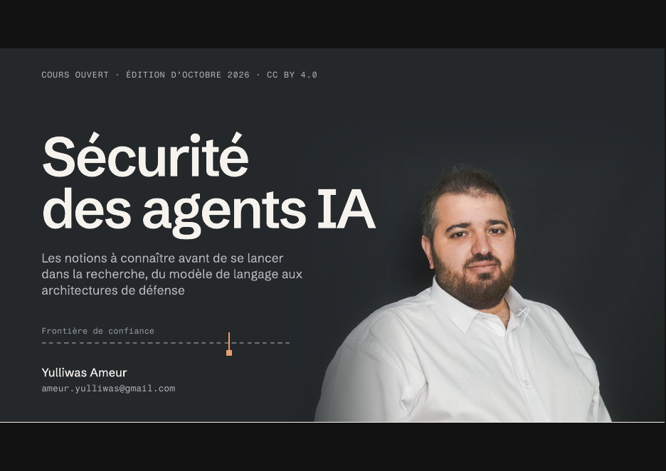

# Sécurité des agents IA — Cours ouvert

Cours ouvert en français sur la **sécurité des agents IA** — systèmes fondés sur des modèles de langage dotés d'outils, de mémoire et d'autonomie. Dix modules, 133 planches, édition d'octobre 2026.

**Auteur :** Yulliwas Ameur — Efrei Research Lab (Efrei Paris) · CEDRIC (Cnam)
**Télécharger :** [`Securite-des-agents-IA_cours-ouvert_2026-10.pdf`](Securite-des-agents-IA_cours-ouvert_2026-10.pdf) · [Zenodo](https://doi.org/10.5281/zenodo.23732189)

## Contenu

| Module | Thème |
|---|---|
| 1 | Vocabulaire : LLM, jetons, prompts système/utilisateur, cycle de vie, embeddings et RAG |
| 2 | Les agents : schéma ReAct, outils, mémoire, planification, degrés d'autonomie, multi-agents, protocoles (MCP, A2A) |
| 3 | Fondamentaux de sécurité : objectifs, vocabulaire du risque, frontière de confiance, authentification vs autorisation, moindre privilège |
| 4 | L'injection de prompt : démonstration, différence avec l'injection SQL, « lethal trifecta » |
| 5 | Panorama des attaques : injection directe/indirecte, exfiltration, CVE-2025-32711 (EchoLeak), détournement d'outils, empoisonnement RAG, chaîne d'approvisionnement MCP, attaques optimisées |
| 6 | Référentiels : OWASP Top 10 for LLM Applications, OWASP Top 10 for Agentic Applications (ASI01–ASI10), MITRE ATLAS, NIST, ANSSI, règlement européen sur l'IA |
| 7 | Défense en profondeur en sept couches : entraînement, délimitation, détection, architecture par flux d'information (CaMeL, FIDES), permissions, validation humaine, tests |
| 8 | Évaluer : métriques, bancs d'essai (AgentDojo, InjecAgent, AgentHarm), « the attacker moves second », grille du relecteur |
| 9 | Pistes de recherche |
| 10 | Glossaire et références |

Un fil rouge (une PME et son assistante IA) illustre chaque module ; chaque module se termine par un auto-test. Public : étudiants en informatique et cybersécurité, ingénieurs, enseignants ; aucun prérequis en apprentissage automatique.

## Citer

> Ameur, Y. (2026). *Sécurité des agents IA — Cours ouvert (édition d'octobre 2026)*. Zenodo. https://doi.org/10.5281/zenodo.23732189

Le DOI ci-dessus désigne toutes les versions et renvoie toujours vers la plus récente. Un fichier [`CITATION.cff`](CITATION.cff) est fourni.

## Contribuer

Ce cours est une ressource ouverte, destinée à évoluer. Erreurs, imprécisions, propositions d'amélioration ou retours d'usage en cours : ouvrez une [issue](../../issues). Chaque nouvelle édition est publiée ici en *release* et archivée sur Zenodo avec un DOI de version.

## Licence

[Creative Commons Attribution 4.0 International (CC BY 4.0)](LICENSE) — réutilisation, adaptation et redistribution libres, y compris à des fins commerciales, à condition de citer l'auteur.
